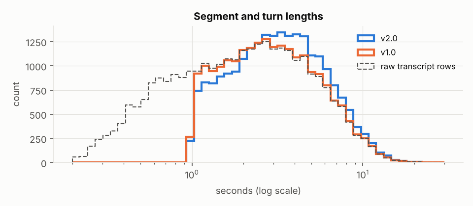
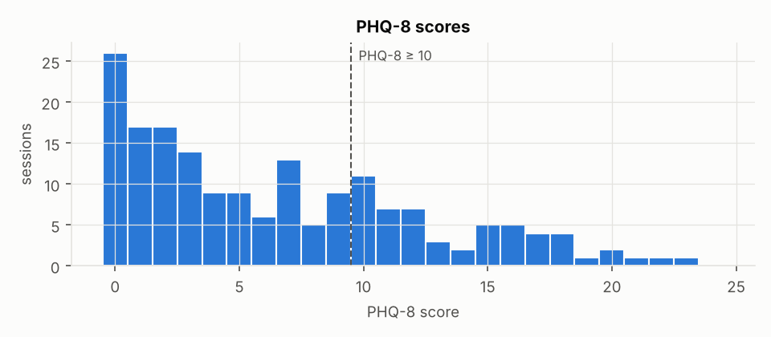
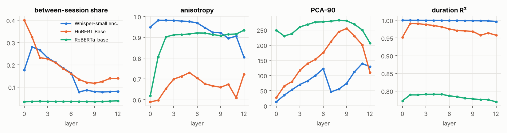
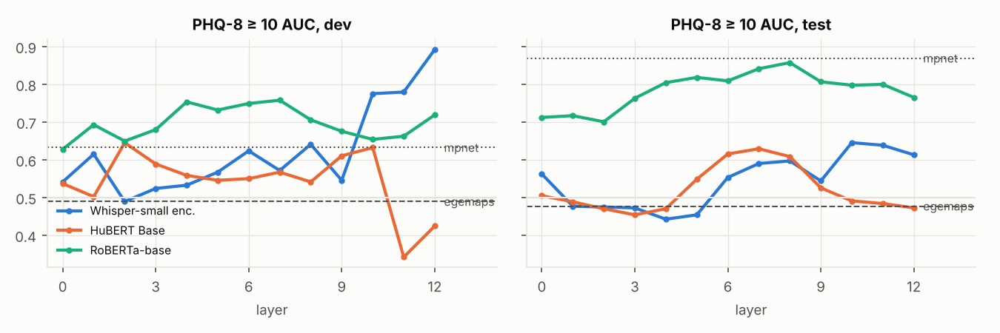

# speech-lab-26

Code for work with the Speech Lab at Columbia: segment-level speech and text embeddings, plus the matching audio, for the
**DAIC-WOZ** depression interview corpus. They support layer-wise probing, interpretability and qualitative work
on Whisper, HuBERT, eGeMAPS and text representations.

The design follows the RFC *"DAIC-WOZ Embedding Generation"*. The current release is **v2.0**:
- **Full corpus:** 179 sessions and 23,088 segments (24.6 h of participant speech), in `GenerationGenerative/daic-woz-embeddings`.
- **Sample:** 6 sessions and 514 segments, for quick tests of the pipeline and probe code, in `GenerationGenerative/daic-woz-embeddings-sample`.

> **Data access.** DAIC-WOZ is released under a EULA from USC ICT. Raw audio, transcripts and every derived
> file (audio clips, embeddings, transcripts, PHQ-8 labels) must stay with people who have signed it. This repo holds
> **code and aggregate statistics only**: `data/` and `outputs/` are git-ignored. The dataset lives in **private** Hugging Face
> dataset repos.

---

## Versions

Versions are git tags on the Hugging Face repos. `main` is the latest one. Pass `revision=` to pin a version.

| tag | short turns (< 1 s) | audio | segments (full) | notes |
|---|---|---|---|---|
| **`v2.0`** (current) | **kept**: merged into the nearest participant turn, spliced across Ellie's line when needed | full sessions (FLAC) + one clip per segment | 23,088 | new columns `intervals`, `n_short_merged`, `spliced` |
| `v1.0` | dropped (24% of transcript rows) | none | 22,083 | |

v2.0 was made because v1.0 dropped every turn under 1 s, which removed most hedges and fillers ("um", "yeah", "mhm", "no").
In v2.0 every participant row from Ellie's first line onward ends up in exactly one segment. See [Segmentation](#2-segmentation-srcspeechlabsegmentpy).

## Descriptive statistics

The full report, with all tables and figures, is [`reports/v2/STATS.md`](reports/v2/STATS.md):
- Every number is also in `reports/v2/stats.json` and `reports/v2/data/*.json`.
- An interactive version, with hover values and downloadable tables, is the private dashboard https://claude.ai/artifact/6466Um6xqGoDz5Vfo92PeB. Ask the repo owner for access.
- Everything is computed with `scripts/analyze.py`.
- It holds aggregates only: no transcript text and no per-session labels.

### Corpus and segments (v2.0)

| split | sessions | depressed (PHQ-8 ≥ 10) | segments | speech (h) |
|---|---|---|---|---|
| train | 102 | 28 | 12,112 | 13.1 |
| dev | 32 | 11 | 4,517 | 4.7 |
| test | 45 | 14 | 6,459 | 6.7 |

**Interviews:**
- **Length:** median 14.1 min (5th–95th percentile 9.1–24.2).
- **Participant talk:** median 7.2 min per session, 75% of all talk time.
- **Turns:** median 154 per session.
- **Speaking rate:** 3.1 words/s.

**Transcript turns:**
- **Length:** the median turn is 1.97 s, and **27.8% of participant rows are shorter than 1 s**.
- **In v2.0:** all 8,454 short rows are kept:
  - 7,320 rows are merged into a neighbouring turn.
  - 1,929 turns are spliced across an Ellie line.
  - 3 turns are split at 30 s.

**Segments:** median 3.18 s, mean 3.84 s, 95th percentile 8.7 s, range 1.0–29.4 s. That compares with v1.0's 2.84 s median and 21.9 h of speech.

**Audio:** median SNR estimate about 31 dB, participant speech level about −41 dBFS, and clipping in only 1 of 179 sessions.

| | |
|---|---|
|  |  |

### Key observations

1. **Short turns are no more common in depressed participants.** The share of turns under 1 s is 0.28 vs 0.29 (r = 0.04, p = 0.67). So v1.0's dropping wasn't biased by group across the full corpus, but v2.0 keeps those turns anyway.
2. **No raw-transcript, audio or eGeMAPS metric separates the groups after correction** (every BH q ≥ 0.19).
   - The largest uncorrected differences are in the depressed group: longer response latency after Ellie (median 1.00 vs 0.84 s, p = 0.011) and more Ellie turns (p = 0.025).
3. **Segment length is a strong confound in the speech embeddings.**
   - Mean-pooled Whisper encoder vectors predict log segment length almost perfectly at every layer (R² ≈ 1.00), even with padding frames removed. The likely cause is the mean of the fixed position embeddings.
   - HuBERT reaches R² 0.95–0.99.
   - Control for length in speech probes.
4. **Speaker and recording identity dominate the early speech layers.**
   - Session means explain 40% of the variance at HuBERT L0 and 28% at Whisper L1. In the upper layers that falls to 8–14%, against 2–4% for text.
   - Gender is perfectly decodable at session level from every speech layer.
   - Depression prevalence differs by gender (35% vs 25%).
5. **Session-level PHQ-8 baselines: text is strong, speech is near chance on test.**
   - Train → dev and train + dev → test, with bootstrap 95% CIs.
   - **Text:** mpnet reaches test AUC 0.87 (0.74–0.97) and RoBERTa L8 0.86. Score RMSE is about 4.4, against 6.5 for predicting the mean.
   - **Speech:** the best layers are Whisper L10 (0.65, 0.48–0.81) and HuBERT L7 (0.63, 0.44–0.81). eGeMAPS reaches 0.48.
   - Mean-pooled speech with a linear probe isn't enough, which is the gap the layer-wise and frame-level work targets.
6. **Linear CKA:** Whisper's middle layers resemble HuBERT's lower layers (Whisper L6 ~ HuBERT L3: 0.72). Whisper's top layer is the speech layer closest to text (Whisper L12 ~ RoBERTa L3: 0.57).

| | |
|---|---|
|  |  |

Comparisons by depression status are descriptive associations on 179 sessions, not findings.

To regenerate the report:

```bash
python scripts/analyze.py --hf GenerationGenerative/daic-woz-embeddings --revision v2.0 --root outputs/full_v2/hf --v1 v1.0 --out reports/v2
```

---

## Reading the data

**Hugging Face repos (private):**
- **Full corpus:** https://huggingface.co/datasets/GenerationGenerative/daic-woz-embeddings
  - **Tables** (segments, pooled embeddings, eGeMAPS, text): about 2.1 GB.
  - **Audio:** full-session FLAC files are about 1.7 GB, and the per-segment clips about 1.1 GB.
  - **Frame-level hidden states:** about 41 GB.
- **Sample:** https://huggingface.co/datasets/GenerationGenerative/daic-woz-embeddings-sample (6 sessions).

Access goes through the `GenerationGenerative` organization: ask an org admin to add you, after you have signed the DAIC-WOZ EULA. If you use a fine-grained token, give it read access to `GenerationGenerative` repos.

### 1. Install and authenticate

```bash
git clone https://github.com/gabelev/speech-lab-26 && cd speech-lab-26
```

```bash
pip install -e .
```

```bash
huggingface-cli login   # or: export HF_TOKEN=hf_...  (a token with read access to the repo)
```

### 2. Load with `EmbeddingDataset`

`src/speechlab/load.py` wraps every table. On first use it downloads the repo into the Hugging Face cache. By default it skips frames and audio, so add `frames=True` or `audio=True` when you need them.

```python
from speechlab.load import EmbeddingDataset

ds = EmbeddingDataset.from_hub(revision="v2.0")            # full corpus, tables only (~2 GB)
# ds = EmbeddingDataset.from_hub(revision="v2.0", audio=True, frames=True)
# ds = EmbeddingDataset.from_hub(revision="v1.0")           # previous release
# sample: EmbeddingDataset.from_hub("GenerationGenerative/daic-woz-embeddings-sample"); local: EmbeddingDataset("outputs/full_v2/hf")

seg = ds.segments()                                    # one row per segment: intervals, text, split, PHQ-8, gender
X   = ds.pooled("hubert_base", layer=9)                # [N, 768] float32, mean over frames
S   = ds.pooled("whisper_small", layer=4, stat="std")  # [N, 768], std over frames
A   = ds.pooled_all_layers("whisper_small")            # [N, 13, 768]
F   = ds.frames("hubert_base", "303_0000_0", layer=6)  # [T, 768] at 50 frames/s (layers 0, 6, 12 only; frames=True)
E   = ds.egemaps()                                     # DataFrame [N, 88], indexed by segment_id
T   = ds.text("roberta_base", layer=12)                # [N, 768]
M   = ds.text("mpnet")                                 # [N, 768]
wav, sr = ds.audio("303_0000_0")                       # the exact audio the models saw (audio=True)
full, sr = ds.session_audio(303)                       # the whole interview, Ellie included (audio=True)

# segment -> session (optionally weighted by segment duration)
Xs, y, sessions = ds.session_pool(X, weight_by_duration=True)
```

Every array's rows are in the same order as `ds.segments()`, so they line up by position.
`segment_id` is the shared key if you'd rather join DataFrames.

**Audio clips** can also be played in the Hugging Face dataset viewer (`audio_clips` config) or loaded with `datasets`:

```python
from datasets import load_dataset
clips = load_dataset("GenerationGenerative/daic-woz-embeddings", "audio_clips", revision="v2.0", split="train")
```

### 3. Example: a layer-wise probe

```python
import numpy as np
from sklearn.linear_model import LogisticRegression
from sklearn.metrics import roc_auc_score
from sklearn.model_selection import GroupKFold

seg = ds.segments()
y, groups = seg.phq8_binary.values, seg.session_id.values
for layer in range(13):
    X = ds.pooled("hubert_base", layer)
    scores = np.zeros(len(y))
    for tr, te in GroupKFold(5).split(X, y, groups):  # never split a session across train and test
        clf = LogisticRegression(C=0.01, max_iter=2000).fit(X[tr], y[tr])
        scores[te] = clf.predict_proba(X[te])[:, 1]
    print(layer, round(roc_auc_score(y, scores), 3))
```

Some caveats:
- Segment-level AUCs pool many segments per speaker. For depression results, report session-level scores on the official train/dev/test splits (`ds.session_pool`).
- Control for segment length and gender (see the statistics above).
- To compare spliced and contiguous segments, filter on `seg.spliced`.

### Quick look and sanity checks

```bash
python examples/read_embeddings.py                       # summary of the HF repo
```

```bash
python scripts/validate.py --hf GenerationGenerative/daic-woz-embeddings --revision v2.0   # consistency checks + probe (frames/audio for 3 sessions)
```

### Without this package

All files are plain parquet, safetensors and FLAC:

```python
import pandas as pd, numpy as np, pyarrow.parquet as pq
from huggingface_hub import snapshot_download

root = snapshot_download("GenerationGenerative/daic-woz-embeddings", repo_type="dataset", revision="v2.0",
                         ignore_patterns=["*/frames/*", "audio/*"])
seg = pd.read_parquet(f"{root}/segments.parquet")
col = pq.read_table(f"{root}/hubert_base/pooled.parquet", columns=["mean_l09"]).column(0).combine_chunks()
X = col.flatten().to_numpy().reshape(len(col), 768).astype(np.float32)
```

---

## Dataset layout

| file | contents |
|---|---|
| `segments.parquet` | `segment_id, session_id, turn_idx, sub_idx, start_s, end_s, dur_s, intervals, text, merged_from, n_short_merged, spliced, text_split_approx, split, phq8_score, phq8_binary, gender` |
| `whisper_small/pooled.parquet` | `mean_l00 … mean_l12`, `std_l00 … std_l12`: one 768-d float16 vector per layer |
| `hubert_base/pooled.parquet` | same layout |
| `{model}/frames/<session>.safetensors` | float16 `[T, 768]` per segment for layers 0, 6, 12. Key `"<segment_id>/layer_XX"`, 50 frames/s |
| `egemaps/functionals.parquet` | `segment_id` + 88 eGeMAPSv02 functionals |
| `text/roberta_base.parquet` | `mean_l00 … mean_l12`: RoBERTa-base token-mean per hidden state |
| `text/mpnet.parquet` | `emb`: all-mpnet-base-v2 sentence embedding (float32) |
| `audio/sessions/<session>.flac` | the whole interview (participant and Ellie), 16 kHz mono, lossless |
| `audio/segments/<session>.parquet` | one FLAC clip per segment (`audio`), exactly the audio the models saw, plus `segment_id, session_id, dur_s, spliced, text` |
| `manifest.json` | dataset version, model ids and commit shas, code commit, full config, library versions, per-session segmentation stats |

Notes on the columns:
- `segment_id = "{session}_{turn_idx:04d}_{sub_idx}"`.
- `intervals` lists the pieces of a segment in session time, and `dur_s` is their total length. `start_s` and `end_s` are the first start and the last end.
- `spliced` marks a segment whose audio joins pieces with an Ellie line cut out between them.
- `n_short_merged` counts the transcript rows under 1 s folded into the segment.
- Layer 0 is the pre-transformer output and layers 1–12 are the transformer blocks. For the Whisper encoder, layer 12 comes after the final layer norm.
- `gender` keeps the 0/1 coding of the DAIC-WOZ split files.
- **Session 440 (dev) is missing:** the DAIC-WOZ server's copy of its zip is truncated, with no zip directory and no transcript. It is listed under `config.failed_sessions` in `manifest.json`.

### Sample (6 sessions, 514 segments)

| split | session | PHQ-8 | depressed | gender | segments | speech (s) |
|---|---|---|---|---|---|---|
| train | 303 | 0 | 0 | 0 | 89 | 653 |
| train | 319 | 13 | 1 | 1 | 77 | 252 |
| dev | 302 | 4 | 0 | 1 | 68 | 232 |
| dev | 335 | 12 | 1 | 0 | 115 | 460 |
| test | 306 | 0 | 0 | 0 | 96 | 513 |
| test | 309 | 15 | 1 | 1 | 69 | 196 |

The dev pair's genders are flipped relative to train and test, so gender isn't confounded with the label across the sample.

---

## How the data is processed

Run end to end with `scripts/run_pipeline.py --config configs/{sample,full}.yaml [--push]`. All parameters are in the config.

### 1. Source data
- Each session comes from the DAIC-WOZ server as `<id>_P.zip`. Only `<id>_AUDIO.wav` (16 kHz mono) and `<id>_TRANSCRIPT.csv` are kept, and the zip is deleted.
- Labels come from `train_split_Depression_AVEC2017.csv`, `dev_split_Depression_AVEC2017.csv` and `full_test_split.csv`. The last is the labelled test split.
- **Excluded sessions:**
  - 342, 394, 398 and 460 are excluded by the corpus itself.
  - 373 and 444 have interruptions mid-interview.
  - 451, 458 and 480 have no Ellie transcript.
  - 318, 321, 341 and 362 have documented transcript timing offsets.
  - 440's zip on the server is truncated. The pipeline skips any session whose zip can't be read and records it in the manifest.

### 2. Segmentation (`src/speechlab/segment.py`)
Every feature type uses the same segments, so all tables join one to one.
1. **Participant turns only.**
   - Ellie's lines are dropped.
   - The only participant rows dropped are setup chatter before Ellie's first line (127 rows in the full corpus) and empty rows.
2. **Short turns (< 1 s) are kept.** A short turn is merged into the participant turn nearest in time, previous or next (ties go to the previous one), and this repeats until the turn is at least 1 s long.
   - **No Ellie line between them:** the two become one contiguous span, including the pause between them.
   - **Ellie line between them:** the short turn's audio is **spliced** on as a separate interval, and Ellie's audio is left out.
   - `merged_from` lists the source transcript rows of each segment.
3. **Long segments (> 30 s of speech)** are split at the quietest 10 ms frame (lowest RMS) in the 3 s before the 30 s mark, measured on the spliced audio. This repeats until every piece is ≤ 30 s. Transcript words are divided between the pieces in proportion to time (`text_split_approx = true`).

### 3. Speech models (`src/speechlab/extract_ssl.py`)
- **Input:** 16 kHz mono, with each model's own feature extractor and no extra amplitude normalization. A segment's audio is the concatenation of its intervals.
- **Whisper-small (`openai/whisper-small`), encoder only.**
  - Whisper pads every input to 30 s, giving 1500 frames.
  - Only the first `ceil(n_samples / 320)` frames are kept, the ones covering real audio, before pooling.
- **HuBERT Base (`facebook/hubert-base-ls960`)** runs at batch size 1, so there's no padding.
- **Layers:** all 13 hidden states are kept for both models. Each layer is pooled to its **mean and population std** over frames and stored as float16.
- **Frame level:** frame-level hidden states are stored for layers **0, 6, 12** (float16), for lexical-erasure work.
- **Pinned versions:** model versions are pinned to commit shas in `configs/full.yaml` and recorded in `manifest.json`.

### 4. eGeMAPS (`src/speechlab/extract_other.py`)
openSMILE `eGeMAPSv02` functionals (88 features) on exactly the same segment audio.

### 5. Text (`src/speechlab/extract_other.py`)
- **RoBERTa-base:** all 13 hidden states, mean-pooled over non-special tokens. This mirrors the speech models' layer structure, so layer-wise probe curves can be compared.
- **all-mpnet-base-v2:** a sentence embedding, as a strong text baseline.

### 6. Audio
- **Full sessions:** each full session is saved as 16 kHz FLAC.
- **Segment clips:** each segment's clip is the concatenation of its intervals, which is the input the models saw. Clips are stored as FLAC bytes in a parquet file per session, with Hugging Face `Audio` feature metadata.

### 7. Publishing and versioning
- **Push (`scripts/run_pipeline.py --push`):**
  - Writes the dataset folder, `manifest.json` and a dataset card.
  - Uploads to the branch named by `output.hf_revision` (`v2` for this release).
  - Refuses to upload unless the repo is private.
- **Promote (`scripts/promote_release.py`):** turns that branch into a release with `scripts/promote_release.py <repo> --branch v2 --tag v2.0`.
  - It makes a single commit on `main` that copies every file server-side, so nothing is re-uploaded, and removes stale paths.
  - It then tags the commit.
  - Older versions stay available by tag.

---

## Repository layout

```
configs/sample.yaml          6-session sample: sessions, segmentation rules, model ids, frame layers, HF repo + branch
configs/full.yaml            full corpus: all sessions, pinned model revisions, incremental frame/audio upload
src/speechlab/
  daicwoz.py                 download, transcript and label loading
  segment.py                 participant-turn segmentation with short-turn merging and splicing
  extract_ssl.py             Whisper-small encoder and HuBERT Base hidden states + pooling
  extract_other.py           eGeMAPS, RoBERTa, mpnet
  store.py                   parquet writers (one column per layer)
  load.py                    EmbeddingDataset reader (tables, frames, audio)
scripts/run_pipeline.py      end-to-end pipeline (cached per session, resumable)
scripts/validate.py          consistency checks + smoke probe
scripts/promote_release.py   promote a staging branch to main and tag the version
scripts/analyze.py           descriptive statistics report (reports/v2)
scripts/dataset_card.md      README template for the HF repo
reports/v2/                  STATS.md, stats.json, figures/, data/*.json (aggregates), dashboard/index.html
examples/read_embeddings.py  loading example
tests/                       segmentation, frame trimming, reader + audio round-trip
```

## Reproducing

```bash
pip install -e ".[dev]"
```

```bash
pytest
```

```bash
python scripts/run_pipeline.py --config configs/sample.yaml           # about 15 min on 4 CPU cores
```

```bash
python scripts/validate.py outputs/sample_v2/hf
```

```bash
python scripts/run_pipeline.py --config configs/full.yaml --threads 4 --push    # full corpus, resumable; needs an HF write token
```

```bash
python scripts/promote_release.py GenerationGenerative/daic-woz-embeddings --branch v2 --tag v2.0 --dry-run
```

**Full run:** the v2.0 corpus took about 8 h of processing on 4 CPU cores.
- Each session is processed separately and marked done in the cache, so a rerun resumes after the last finished session.
- Frame and audio files are uploaded every 10 sessions and then deleted locally.
- `--shard i/n` splits the sessions across machines; once all shards are done, run `--assemble-only`.

**Run cost on 4 CPU cores:**
- Whisper-small takes about 1 s per segment, because it pads every input to 30 s.
- HuBERT takes about 0.25 s per segment.
- eGeMAPS and the text models take under a minute in total.

## Open decisions
- Small vs. extended DAIC-WOZ.
- How to handle the segment-length confound in speech probes: residualize, length-matched sampling, or frame-level models.
- Whether spliced segments (8% of segments) should be excluded from some analyses.
- Duration weighting when pooling segments to sessions (`session_pool(weight_by_duration=...)` supports both).
- Which layers to keep at frame level.
