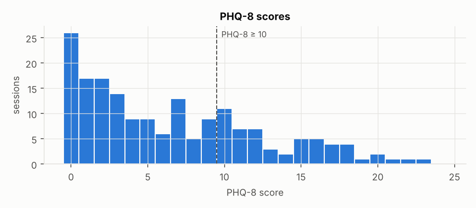
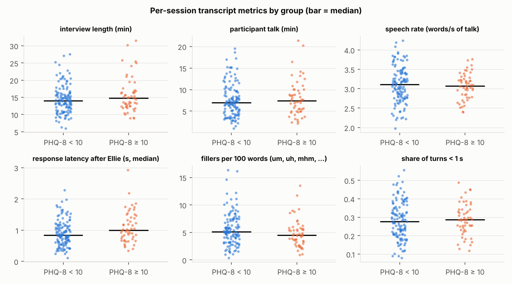
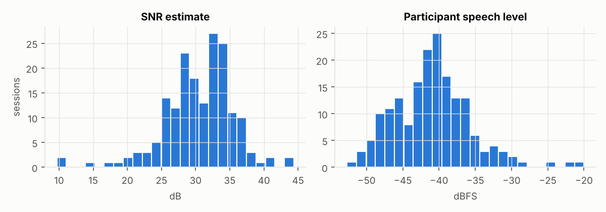
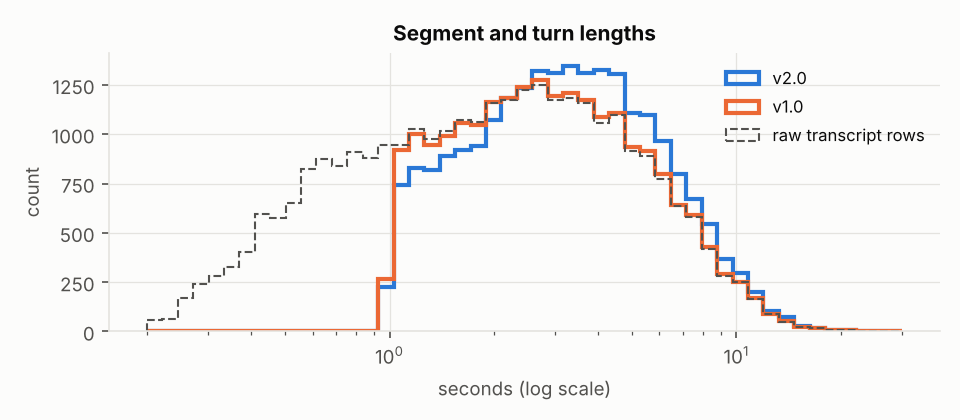
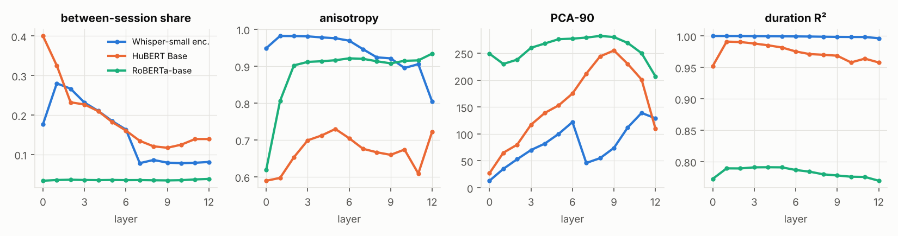
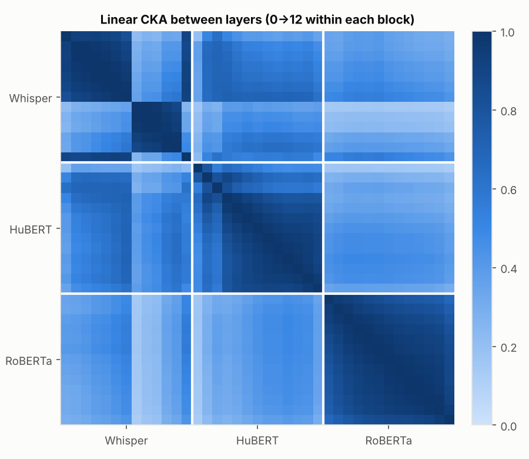
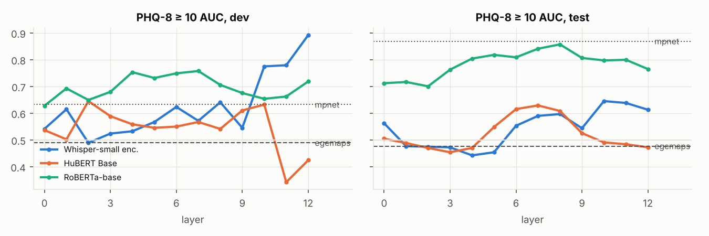

# DAIC-WOZ embeddings v2.0: descriptive statistics

Generated by `scripts/analyze.py` from dataset version 2.0 (code 3ee66b1). The figures are in `figures/`, and every number is also in `stats.json`.

> All figures here are aggregates. There's no transcript text and no per-session label table, so this file can live in the code repo. Comparisons between depressed (PHQ-8 ≥ 10) and non-depressed participants are descriptive associations on a small sample, not findings. p-values are uncorrected Mann–Whitney tests, q-values are Benjamini–Hochberg across the metrics in each table, and r is the rank-biserial effect size (positive means higher in the depressed group).

## Key observations

*This section is hand-written. Everything below it is generated by `scripts/analyze.py`.*

1. **v2 keeps every short turn.**
   - All 8,454 participant rows under 1 s (27.8% of rows) are now inside a segment: 7,320 rows were merged into a neighbouring turn, and 1,929 turns were spliced across an Ellie line.
   - The corpus grows from 22,083 to **23,088 segments** and from 21.9 h to **24.6 h** of speech. The median segment length goes from 2.84 s to 3.18 s.
   - No segment is shorter than 1 s, and only 3 turns needed a 30 s split.
2. **Short turns aren't more common in depressed participants.**
   - The share of turns under 1 s is 0.28 vs 0.29 (r = 0.04, p = 0.67).
   - The concern from the 6-session sample, that v1 dropped more speech from depressed participants, doesn't hold across the full corpus. v2 removes the question anyway.
3. **No raw-transcript or audio metric separates the groups after correction** (every q ≥ 0.19).
   - The largest uncorrected differences are a longer response latency after Ellie (median 1.00 vs 0.84 s, r = 0.24, p = 0.011) and more Ellie turns (r = 0.21, p = 0.025) in the depressed group. The extra Ellie turns plausibly reflect her follow-up prompts.
   - Fillers, hedges and first-person pronouns differ by |r| ≤ 0.17.
   - Recording quality is similar in both groups (median SNR about 31 dB). One session has clipping.
4. **Segment length is a major confound in the speech embeddings.**
   - Whisper's mean-pooled encoder vectors predict log segment length almost perfectly at every layer (R² ≈ 1.00), even with padding frames removed. The likely reason is that the mean of the fixed sinusoidal position embeddings over the first *n* frames encodes *n*.
   - HuBERT reaches R² 0.95–0.99, and text 0.70–0.79 (presumably through word count).
   - Speech-only probes should control for length: residualize it, match it, or use the `std_` stats or frames.
5. **Speaker and recording identity dominate the early speech layers.**
   - Session means explain 40% of the variance at HuBERT layer 0 and 28% at Whisper layer 1. This falls to 8–14% in the upper layers, against 2–4% for text.
   - At session level, gender is perfectly decodable from every speech layer (AUC 1.00).
   - Depression prevalence differs by gender (35% for gender 0 vs 25% for gender 1), so speech probes need gender-stratified checks.
6. **Text dominates the session-level PHQ-8 baselines; speech is near chance on test.**
   - Text: mpnet reaches a test AUC of 0.87 (95% CI 0.74–0.97) and RoBERTa layer 8 reaches 0.86. Their score RMSE is about 4.4, against 6.5 for predicting the mean.
   - Speech: the best layers are Whisper L10 (0.65, CI 0.48–0.81) and HuBERT L7 (0.63, CI 0.44–0.81). Both CIs include 0.5. Whisper L12's dev AUC of 0.89 falls to 0.61 on test.
   - eGeMAPS is at chance (0.48).
   - Mean-pooled speech plus a linear probe isn't enough, which motivates the layer-wise and frame-level work.
7. **Representational similarity (linear CKA).**
   - Whisper's middle layers resemble HuBERT's lower layers (Whisper L6 ~ HuBERT L3: 0.72).
   - Whisper's top layer is the speech layer closest to text (Whisper L12 ~ RoBERTa L3: 0.57), which is consistent with its upper encoder layers being more lexical.

## 1. Corpus

| split | sessions | PHQ-8 ≥ 10 | gender = 1 | PHQ-8 mean | PHQ-8 median |
|---|---|---|---|---|---|
| train | 102 | 28 | 62 | 6.2 | 5 |
| dev | 32 | 11 | 16 | 7.2 | 6 |
| test | 45 | 14 | 21 | 7.1 | 5 |

Gender (source coding 0/1) × PHQ-8 ≥ 10: gender 0: 28 of 80 depressed; gender 1: 25 of 99 depressed.

## 2. Raw transcripts (before segmentation)

These stats are computed from the original transcript rows, from Ellie's first line onward. Talk time is the sum of transcript row durations.

| metric (per session) | median | 5th–95th pct | median PHQ<10 | median PHQ≥10 | r | p | q |
|---|---|---|---|---|---|---|---|
| interview length (min) | 14.09 | 9.08 – 24.21 | 14.05 | 14.83 | 0.11 | 0.228 | 0.692 |
| participant talk (min) | 7.17 | 2.80 – 15.15 | 6.95 | 7.44 | 0.06 | 0.541 | 0.763 |
| participant share of talk | 0.75 | 0.53 – 0.87 | 0.74 | 0.77 | 0.10 | 0.285 | 0.692 |
| participant turns | 154.00 | 81.30 – 326.10 | 150.50 | 158.00 | 0.08 | 0.400 | 0.763 |
| Ellie turns | 80.00 | 58.70 – 103.00 | 78.00 | 84.00 | 0.21 | 0.025 | 0.214 |
| participant words | 1,253.00 | 487.80 – 3,031.30 | 1,250.00 | 1,379.00 | 0.04 | 0.669 | 0.763 |
| words per turn | 8.09 | 4.53 – 14.51 | 8.36 | 7.30 | -0.05 | 0.628 | 0.763 |
| speech rate (words/s of talk) | 3.10 | 2.40 – 3.82 | 3.11 | 3.07 | -0.05 | 0.597 | 0.763 |
| median turn length (s) | 1.93 | 1.13 – 3.86 | 1.93 | 1.94 | -0.05 | 0.593 | 0.763 |
| share of turns < 1 s | 0.28 | 0.13 – 0.45 | 0.28 | 0.29 | 0.04 | 0.673 | 0.763 |
| response latency after Ellie (s, median) | 0.90 | 0.38 – 1.74 | 0.84 | 1.00 | 0.24 | 0.011 | 0.190 |
| fillers per 100 words (um, uh, mhm, ...) | 4.97 | 1.60 – 10.48 | 5.09 | 4.47 | -0.17 | 0.073 | 0.309 |
| hedges per 100 words (I don't know, kind of, maybe, ...) | 1.98 | 0.74 – 4.41 | 1.95 | 1.99 | 0.01 | 0.943 | 0.943 |
| first-person singular per 100 words | 9.77 | 7.13 – 13.12 | 9.67 | 9.94 | 0.17 | 0.072 | 0.309 |
| non-verbal tags per min of talk | 1.46 | 0.21 – 5.22 | 1.42 | 1.80 | 0.07 | 0.488 | 0.763 |
| laughter per min of talk | 0.79 | 0.00 – 3.69 | 0.73 | 0.98 | 0.10 | 0.280 | 0.692 |
| unintelligible (xxx) per 100 words | 0.00 | 0.00 – 0.30 | 0.00 | 0.00 | -0.02 | 0.827 | 0.879 |

**Turn lengths** (all 30,405 participant rows): median 1.97 s, 27.8% shorter than 1 s, 95th percentile 7.6 s.

## 3. Raw audio (full session recordings)

Levels are in dBFS from 25 ms frames. **Participant speech** is the energy inside segment intervals. The **noise floor** is the 10th percentile of frame energy over the whole recording, and **SNR** is participant speech minus noise floor, which is a rough figure.

| metric (per session) | median | 5th–95th pct | median PHQ<10 | median PHQ≥10 | r | p | q |
|---|---|---|---|---|---|---|---|
| recording length (min) | 15.20 | 10.05 – 25.28 | 15.16 | 15.90 | 0.11 | 0.240 | 0.440 |
| overall level (dBFS) | -43.65 | -51.03 – -33.67 | -43.80 | -42.74 | 0.07 | 0.463 | 0.617 |
| participant speech level (dBFS) | -40.91 | -48.65 – -31.81 | -40.95 | -40.77 | 0.03 | 0.732 | 0.732 |
| noise floor (dBFS) | -72.52 | -75.30 – -65.54 | -72.46 | -72.53 | -0.04 | 0.675 | 0.732 |
| SNR estimate (dB) | 30.89 | 22.03 – 36.93 | 30.57 | 31.93 | 0.10 | 0.275 | 0.440 |
| peak (dBFS) | -7.84 | -19.93 – 0.00 | -8.61 | -2.77 | 0.15 | 0.117 | 0.440 |
| clipped samples (%) | 0.00 | 0.00 – 0.00 | 0.00 | 0.00 | 0.12 | 0.127 | 0.440 |
| DC offset | -0.00 | -0.00 – -0.00 | -0.00 | -0.00 | -0.13 | 0.182 | 0.440 |

1 of 179 sessions has more than 0.01% clipped samples.

## 4. Segments

**Compared with v1.0** (the same sessions):

|  | v2.0 | v1.0 |
|---|---|---|
| segments | 23,088 | 22,083 |
| segment length median (s) | 3.18 | 2.84 |
| segments shorter than 2 s | 5,884 | 6,775 |
| participant speech in segments (h) | 24.63 | 21.88 |

|  | value |
|---|---|
| segments | 23,088 |
| segments per session (median, range) | 117 (33–344) |
| segment length (s): median / mean / 95th pct | 3.18 / 3.84 / 8.71 |
| words per segment (median) | 9 |
| participant speech in segments (h) | 24.6 |
| participant transcript rows | 30,532 |
| rows before the interview (dropped) | 127 |
| empty rows (dropped) | 0 |
| short rows (< 1 s), all kept | 8,454 |
| rows merged into another turn | 7,320 |
| turns spliced across an Ellie line | 1,929 |
| turns split at 30 s | 3 |
| segments containing a short turn | 6,215 |
| segments shorter than 1 s | 0 |

## 5. Embeddings

These are computed on segment mean-pooled vectors (float16 stored, float32 here). **Anisotropy** is the mean pairwise cosine similarity, where 0 means isotropic. **PCA-90** is the number of principal components that explain 90% of the variance. **Between-session share** is the fraction of total variance explained by session means, so a high value means the layer mostly encodes who is speaking and the recording. **Duration R²** is a ridge regression from the layer to log segment length, with session-grouped 5-fold CV. **Gender AUC** is a session-level 5-fold CV probe.

**Whisper-small enc.**

| layer | between-session share | anisotropy | PCA-90 | duration R² | gender AUC | mean norm |
|---|---|---|---|---|---|---|
| 0 | 0.18 | 0.95 | 13 | 1.00 | 1.00 | 19.61 |
| 1 | 0.28 | 0.98 | 35 | 1.00 | 1.00 | 15.73 |
| 2 | 0.27 | 0.98 | 53 | 1.00 | 1.00 | 15.95 |
| 3 | 0.23 | 0.98 | 70 | 1.00 | 1.00 | 16.14 |
| 4 | 0.21 | 0.98 | 82 | 1.00 | 1.00 | 16.14 |
| 5 | 0.18 | 0.98 | 100 | 1.00 | 1.00 | 16.22 |
| 6 | 0.16 | 0.97 | 122 | 1.00 | 1.00 | 16.25 |
| 7 | 0.08 | 0.95 | 46 | 1.00 | 1.00 | 16.78 |
| 8 | 0.09 | 0.92 | 55 | 1.00 | 1.00 | 17.15 |
| 9 | 0.08 | 0.92 | 74 | 1.00 | 1.00 | 18.09 |
| 10 | 0.08 | 0.90 | 112 | 1.00 | 1.00 | 19.70 |
| 11 | 0.08 | 0.91 | 139 | 1.00 | 1.00 | 24.56 |
| 12 | 0.08 | 0.80 | 129 | 1.00 | 1.00 | 23.65 |

**HuBERT Base**

| layer | between-session share | anisotropy | PCA-90 | duration R² | gender AUC | mean norm |
|---|---|---|---|---|---|---|
| 0 | 0.40 | 0.59 | 27 | 0.95 | 1.00 | 2.61 |
| 1 | 0.33 | 0.60 | 65 | 0.99 | 1.00 | 2.06 |
| 2 | 0.23 | 0.65 | 80 | 0.99 | 1.00 | 2.79 |
| 3 | 0.23 | 0.70 | 117 | 0.99 | 1.00 | 2.76 |
| 4 | 0.21 | 0.71 | 139 | 0.99 | 1.00 | 2.82 |
| 5 | 0.18 | 0.73 | 153 | 0.98 | 1.00 | 2.91 |
| 6 | 0.16 | 0.70 | 175 | 0.98 | 1.00 | 2.90 |
| 7 | 0.13 | 0.68 | 212 | 0.97 | 1.00 | 2.90 |
| 8 | 0.12 | 0.67 | 244 | 0.97 | 1.00 | 2.98 |
| 9 | 0.12 | 0.66 | 255 | 0.97 | 1.00 | 3.22 |
| 10 | 0.12 | 0.67 | 230 | 0.96 | 1.00 | 3.37 |
| 11 | 0.14 | 0.61 | 201 | 0.96 | 1.00 | 2.93 |
| 12 | 0.14 | 0.72 | 110 | 0.96 | 1.00 | 4.96 |

**RoBERTa-base**

| layer | between-session share | anisotropy | PCA-90 | duration R² | gender AUC | mean norm |
|---|---|---|---|---|---|---|
| 0 | 0.03 | 0.62 | 249 | 0.77 | 0.83 | 4.96 |
| 1 | 0.04 | 0.81 | 230 | 0.79 | 0.83 | 13.11 |
| 2 | 0.04 | 0.90 | 238 | 0.79 | 0.83 | 18.80 |
| 3 | 0.04 | 0.91 | 260 | 0.79 | 0.84 | 19.05 |
| 4 | 0.03 | 0.91 | 268 | 0.79 | 0.84 | 19.23 |
| 5 | 0.04 | 0.92 | 276 | 0.79 | 0.84 | 21.46 |
| 6 | 0.03 | 0.92 | 277 | 0.79 | 0.85 | 22.24 |
| 7 | 0.03 | 0.92 | 279 | 0.78 | 0.84 | 23.02 |
| 8 | 0.03 | 0.91 | 282 | 0.78 | 0.83 | 23.13 |
| 9 | 0.03 | 0.91 | 280 | 0.78 | 0.82 | 23.27 |
| 10 | 0.03 | 0.91 | 269 | 0.78 | 0.81 | 23.73 |
| 11 | 0.04 | 0.92 | 250 | 0.78 | 0.81 | 23.09 |
| 12 | 0.04 | 0.93 | 207 | 0.77 | 0.81 | 12.49 |

| features | between-session share | anisotropy | PCA-90 | duration R² | gender AUC | mean norm |
|---|---|---|---|---|---|---|
| mpnet | 0.02 | 0.13 | 242 | 0.70 | 0.81 | 1.00 |
| egemaps | 0.31 | 0.00 | 37 | 0.46 | 1.00 | 8.06 |

eGeMAPS is z-scored per feature before the geometry measures.

### Representational similarity (linear CKA)

This is computed on 4,000 random segments. The most similar layer pair for each model pair is: Whisper-small enc. L6 ~ HuBERT Base L3: 0.72; Whisper-small enc. L12 ~ RoBERTa-base L3: 0.57; HuBERT Base L9 ~ RoBERTa-base L3: 0.50.

### Session-level PHQ-8 probes

- **Features:** segment vectors are averaged into one vector per session, weighted by duration.
- **Models:** logistic regression for PHQ-8 ≥ 10 (AUC) and ridge regression for the PHQ-8 score (RMSE). Hyperparameters are chosen by 5-fold CV within the training sessions.
- **Evaluation:** train on train and score on dev; train on train + dev and score on test.
- **Uncertainty:** the 95% intervals are a bootstrap over test sessions. With only 32 to 45 evaluation sessions they are wide, so read the curves as a baseline, not a result.

| features | layer | AUC dev | AUC test | test 95% CI | RMSE test | RMSE mean-only |
|---|---|---|---|---|---|---|
| Whisper-small enc. | 0 | 0.54 | 0.56 | 0.38–0.75 | 6.49 | 6.51 |
| Whisper-small enc. | 1 | 0.61 | 0.48 | 0.27–0.69 | 6.49 | 6.51 |
| Whisper-small enc. | 2 | 0.49 | 0.47 | 0.28–0.67 | 6.44 | 6.51 |
| Whisper-small enc. | 3 | 0.52 | 0.47 | 0.29–0.67 | 6.44 | 6.51 |
| Whisper-small enc. | 4 | 0.53 | 0.44 | 0.29–0.63 | 6.42 | 6.51 |
| Whisper-small enc. | 5 | 0.57 | 0.45 | 0.25–0.68 | 6.42 | 6.51 |
| Whisper-small enc. | 6 | 0.62 | 0.55 | 0.36–0.74 | 6.38 | 6.51 |
| Whisper-small enc. | 7 | 0.57 | 0.59 | 0.39–0.76 | 6.36 | 6.51 |
| Whisper-small enc. | 8 | 0.64 | 0.60 | 0.40–0.79 | 6.15 | 6.51 |
| Whisper-small enc. | 9 | 0.55 | 0.54 | 0.33–0.74 | 6.31 | 6.51 |
| Whisper-small enc. | 10 | 0.77 | 0.65 | 0.48–0.81 | 6.39 | 6.51 |
| Whisper-small enc. | 11 | 0.78 | 0.64 | 0.48–0.79 | 6.38 | 6.51 |
| Whisper-small enc. | 12 | 0.89 | 0.61 | 0.43–0.77 | 6.44 | 6.51 |
| HuBERT Base | 0 | 0.54 | 0.50 | 0.31–0.70 | 6.39 | 6.51 |
| HuBERT Base | 1 | 0.50 | 0.49 | 0.32–0.70 | 6.42 | 6.51 |
| HuBERT Base | 2 | 0.65 | 0.47 | 0.26–0.65 | 6.42 | 6.51 |
| HuBERT Base | 3 | 0.59 | 0.45 | 0.26–0.67 | 6.45 | 6.51 |
| HuBERT Base | 4 | 0.56 | 0.47 | 0.25–0.65 | 6.38 | 6.51 |
| HuBERT Base | 5 | 0.55 | 0.55 | 0.36–0.73 | 6.34 | 6.51 |
| HuBERT Base | 6 | 0.55 | 0.62 | 0.43–0.79 | 6.33 | 6.51 |
| HuBERT Base | 7 | 0.57 | 0.63 | 0.44–0.81 | 6.35 | 6.51 |
| HuBERT Base | 8 | 0.54 | 0.61 | 0.42–0.78 | 6.30 | 6.51 |
| HuBERT Base | 9 | 0.61 | 0.53 | 0.33–0.74 | 6.31 | 6.51 |
| HuBERT Base | 10 | 0.63 | 0.49 | 0.29–0.70 | 6.35 | 6.51 |
| HuBERT Base | 11 | 0.34 | 0.48 | 0.27–0.70 | 6.35 | 6.51 |
| HuBERT Base | 12 | 0.42 | 0.47 | 0.25–0.66 | 6.41 | 6.51 |
| RoBERTa-base | 0 | 0.63 | 0.71 | 0.52–0.86 | 5.25 | 6.51 |
| RoBERTa-base | 1 | 0.69 | 0.72 | 0.53–0.87 | 5.53 | 6.51 |
| RoBERTa-base | 2 | 0.65 | 0.70 | 0.53–0.85 | 5.14 | 6.51 |
| RoBERTa-base | 3 | 0.68 | 0.76 | 0.60–0.90 | 4.53 | 6.51 |
| RoBERTa-base | 4 | 0.75 | 0.80 | 0.66–0.93 | 4.49 | 6.51 |
| RoBERTa-base | 5 | 0.73 | 0.82 | 0.68–0.94 | 4.51 | 6.51 |
| RoBERTa-base | 6 | 0.75 | 0.81 | 0.64–0.93 | 4.48 | 6.51 |
| RoBERTa-base | 7 | 0.76 | 0.84 | 0.73–0.96 | 4.40 | 6.51 |
| RoBERTa-base | 8 | 0.71 | 0.86 | 0.73–0.95 | 5.11 | 6.51 |
| RoBERTa-base | 9 | 0.68 | 0.81 | 0.66–0.92 | 5.20 | 6.51 |
| RoBERTa-base | 10 | 0.65 | 0.80 | 0.65–0.92 | 5.17 | 6.51 |
| RoBERTa-base | 11 | 0.66 | 0.80 | 0.66–0.92 | 5.14 | 6.51 |
| RoBERTa-base | 12 | 0.72 | 0.76 | 0.62–0.89 | 4.46 | 6.51 |
| mpnet | – | 0.63 | 0.87 | 0.74–0.97 | 4.46 | 6.51 |
| egemaps | – | 0.49 | 0.48 | 0.28–0.67 | 6.48 | 6.51 |

### eGeMAPS by group (per-session duration-weighted means)

| metric (per session) | median | 5th–95th pct | median PHQ<10 | median PHQ≥10 | r | p | q |
|---|---|---|---|---|---|---|---|
| F0 mean (semitones) | 26.54 | 20.07 – 34.37 | 25.61 | 29.51 | 0.12 | 0.207 | 0.768 |
| F0 variability | 0.09 | 0.06 – 0.12 | 0.09 | 0.09 | -0.06 | 0.512 | 0.768 |
| loudness mean | 0.14 | 0.08 – 0.29 | 0.14 | 0.14 | -0.04 | 0.639 | 0.821 |
| jitter | 0.02 | 0.01 – 0.03 | 0.02 | 0.02 | 0.02 | 0.871 | 0.871 |
| shimmer (dB) | 0.97 | 0.76 – 1.20 | 0.98 | 0.94 | -0.08 | 0.375 | 0.768 |
| HNR (dB) | 6.28 | 3.32 – 9.76 | 5.81 | 7.33 | 0.14 | 0.151 | 0.768 |
| voiced segments per s | 2.21 | 1.71 – 2.67 | 2.21 | 2.20 | -0.07 | 0.476 | 0.768 |
| mean unvoiced segment (s) | 0.27 | 0.16 – 0.53 | 0.26 | 0.28 | 0.09 | 0.327 | 0.768 |
| equivalent sound level (dB) | -42.07 | -50.00 – -32.74 | -42.09 | -41.93 | 0.02 | 0.804 | 0.871 |

### Frame-level outputs

These are from the first 5 sessions. **Adjacent cos** is the mean cosine similarity between consecutive 20 ms frames, a measure of how smooth each layer is over time.

| model | layer | frames | mean norm | adjacent cos |
|---|---|---|---|---|
| HuBERT Base | 0 | 95,064 | 5.73 | 0.70 |
| HuBERT Base | 6 | 95,064 | 8.10 | 0.82 |
| HuBERT Base | 12 | 95,064 | 11.79 | 0.86 |
| Whisper-small enc. | 0 | 95,448 | 23.63 | 0.97 |
| Whisper-small enc. | 6 | 95,448 | 18.91 | 0.92 |
| Whisper-small enc. | 12 | 95,448 | 43.44 | 0.81 |

